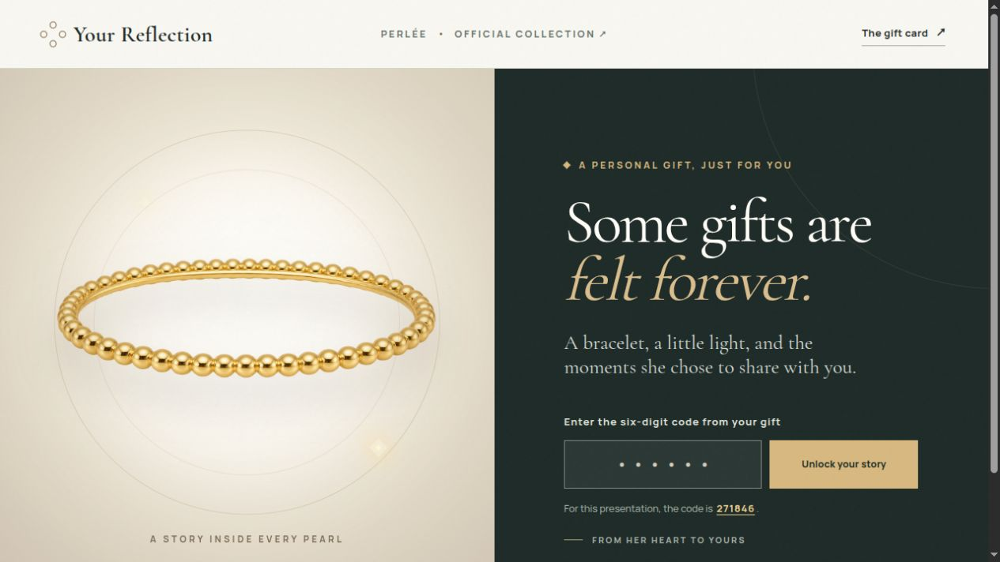
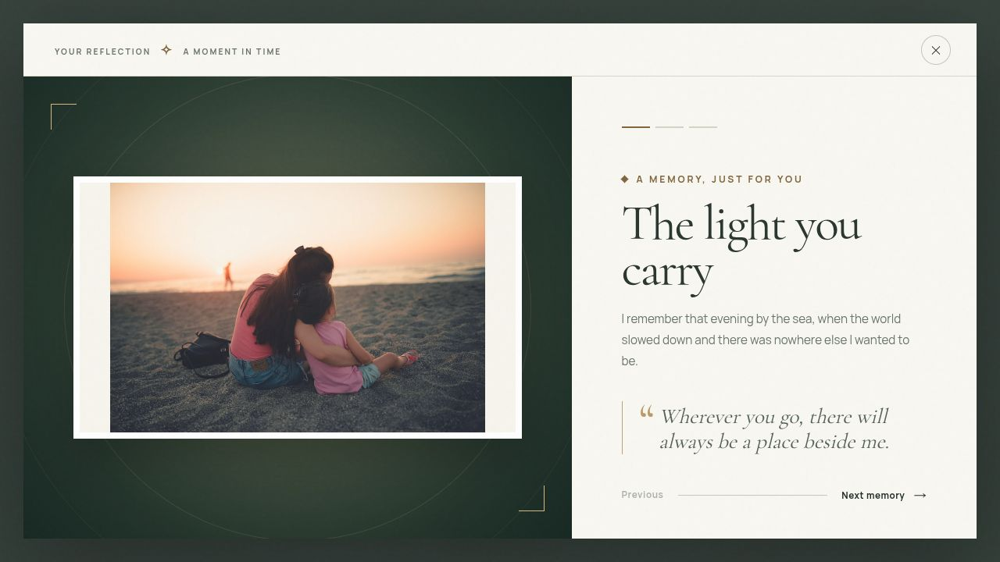
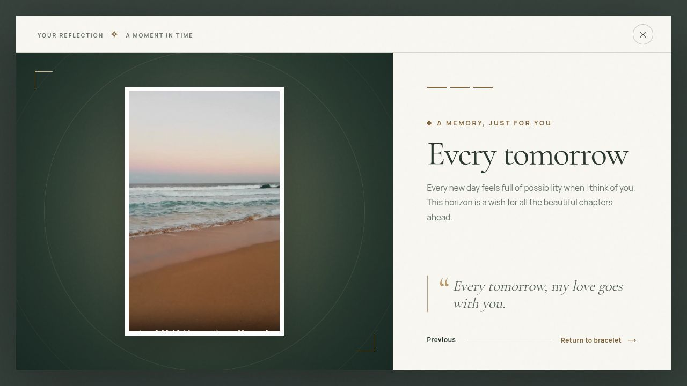
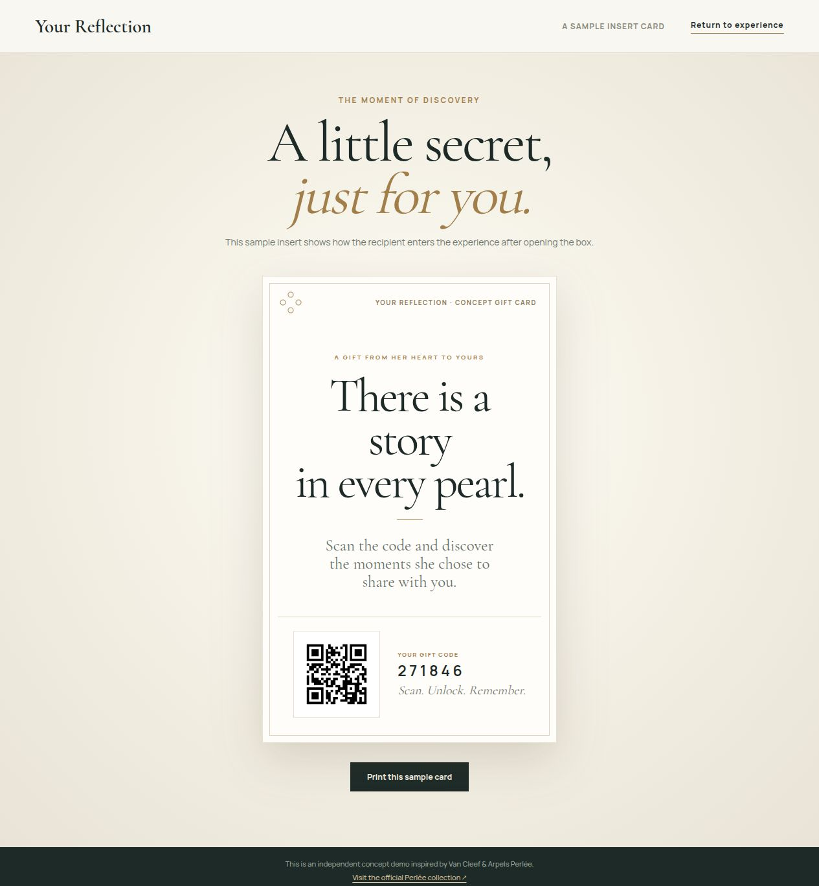

# Your Reflection

**A story in every pearl.** Your Reflection is an interactive jewelry gift concept. A recipient scans a card, enters a six-digit demo code, and opens three memories held inside a bracelet.

[](LICENSE)  

[Quick start](#quick-start) · [Experience](#the-experience) · [Development](#development) · [Troubleshooting](#troubleshooting)

> **Independent concept demo.** This project is inspired by the [Van Cleef & Arpels Perlée collection](https://www.vancleefarpels.com/ae/en/collections/jewelry/perlee.html). It is not an official website, product, or integration. The experience links visitors to the official collection.


## The experience

| Enter the gift code | Discover a memory |
| --- | --- |
|  |  |

| Watch the third memory | Share the gift card |
| --- | --- |
|  |  |

The card's QR opens the recipient page. The demo code is **`271846`**. Three pearls reveal two sample photos and a sample video; visitors can switch between **Golden glow** and **Memory glimpses**, or use the memory list. The purchase and upload journey is a concept; this repository implements the recipient experience and printable card.

## Quick start

**Requirements:** [Docker with Compose](https://docs.docker.com/compose/install/), an available TCP port **8765**, and a computer and test phone on the **same Wi-Fi or LAN**.

1. Clone or download this repository and open its folder.
2. Run the launcher for your operating system:

   | System | Start command |
   | --- | --- |
   | Linux | `./start-linux.sh` |
   | macOS | `./start-macos.sh` |
   | Windows | Double-click `start-windows.cmd`, or run `powershell -NoProfile -ExecutionPolicy Bypass -File .\start-windows.ps1` |

   For example, on Linux:

   ```bash
   git clone https://github.com/p-ktz/your-reflection.git
   cd your-reflection
   ./start-linux.sh
   ```

3. Open the printed **Gift card** URL in your browser. Scan its QR with the phone, then enter **`271846`**.

The launcher checks Docker, detects the computer's LAN address, builds the image, waits for the page to respond, and prints the site and gift card URLs. Keep Docker and the computer running while others test. The QR is regenerated for the current address; the QR visible in README screenshots is only an example.

**Stop the demo** from the repository folder:

```bash
docker compose down
```

`PUBLIC_HOST` is **not needed** for `down`. If the launcher picks the wrong adapter, set the host IP explicitly:

| System | Example |
| --- | --- |
| Linux | `./start-linux.sh --ip 192.168.1.23` |
| macOS | `./start-macos.sh --ip 192.168.1.23` |
| Windows PowerShell | `powershell -NoProfile -ExecutionPolicy Bypass -File .\start-windows.ps1 -HostIp 192.168.1.23` |

### Direct Compose commands

The launchers are the simplest way to create a phone-accessible QR. If running Compose manually, set `PUBLIC_HOST` to the computer's LAN IP:

```bash
PUBLIC_HOST=192.168.1.23 docker compose up --build -d
docker compose down
```

On Windows PowerShell, run `$env:PUBLIC_HOST = "192.168.1.23"` before `docker compose up --build -d`. Without `PUBLIC_HOST`, Compose uses `127.0.0.1`, so the page works on the host computer but the QR will not open from another phone.

## Development

Edit the hand-written frontend files in `dist/`. Development mode bind-mounts that folder and refreshes open pages after a save:

```bash
PUBLIC_HOST=192.168.1.23 docker compose -f compose.yaml -f compose.dev.yaml up --build -d
```

`compose.dev.yaml` is an **override**, so it must be used **with** `compose.yaml` as shown. On Windows PowerShell, set `$env:PUBLIC_HOST = "192.168.1.23"` first, then run the same `docker compose -f ...` command. Stop development mode with `docker compose -f compose.yaml -f compose.dev.yaml down`.

| Change | Where |
| --- | --- |
| Memory text, media, and order | `memories` in [`dist/app.js`](dist/app.js) |
| Pearl positions, preview scale, opacity, and blur | `MEMORY GLIMPSES CONTROLS` and `.pearl-one` / `.pearl-two` / `.pearl-three` in [`dist/styles.css`](dist/styles.css) |
| Layout, typography, colors, and motion | [`dist/styles.css`](dist/styles.css) and [`dist/gift-card.css`](dist/gift-card.css) |
| Demo code | `DEMO_CODE` in `dist/app.js`, plus the visible hints in `dist/index.html` and `dist/gift-card.html` |

`server.py` is the container's small HTTP server. It generates the QR and enables development refresh. The runtime QR SVG is ignored by Git; do not distribute a QR tied to your own LAN address.

<details>
<summary>Repository map</summary>

```text
.
├── dist/                  Hand-written site, card, styles, scripts, fonts, sample media
├── docs/screenshots/      Screenshots used in this README
├── server.py              Container server, QR generation, development refresh
├── start-linux.sh         Linux Docker launcher
├── start-macos.sh         macOS Docker launcher
├── start-windows.cmd      Windows double-click launcher
├── start-windows.ps1      Windows PowerShell Docker launcher
├── scripts/               Shared Unix launcher logic
├── Dockerfile             Container image
├── compose.yaml           Normal demo
├── compose.dev.yaml       Development override
└── vendor/                Bundled QR library and font license notices
```

</details>

## Troubleshooting

| Symptom | Check |
| --- | --- |
| Docker is missing, stopped, or inaccessible | Install/start Docker with Compose and rerun the launcher. Its error message distinguishes these cases. |
| The phone cannot open the QR | Use the same Wi-Fi/LAN, keep the host awake, allow TCP `8765` through the firewall, and avoid guest networks that isolate devices. |
| The QR points to an old or wrong address | Restart the launcher or pass `--ip` / `-HostIp` with the correct LAN address. |
| Port `8765` is in use | Stop the other process/container using that port, then rerun the launcher. |
| `compose.dev.yaml` alone fails | It is an override; pass `-f compose.yaml -f compose.dev.yaml`. |

The QR contains a URL; it does not make a local computer reachable over the internet. For access from other networks, deploy to a server with a public domain, HTTPS, and proper access control.

## Accessibility and limitations

The memory dialog supports keyboard navigation, Escape, touch swipes, focus return, visible focus, and reduced-motion preferences. The video has an accessible description and no subtitles.

The six-digit code is a **client-side presentation step, not authentication**. Anyone who can reach the demo server can request its sample media files directly. Do not host private memories with this demo without server-side access control, secure storage, consent handling, and HTTPS.

## Media and licenses

The sample memories come from Wikimedia Commons; previews are crops, and the video was trimmed, muted, resized, and converted for this demo. Keep these credits with redistributed copies:

| Asset | Source | License |
| --- | --- | --- |
| `memory-seaside.jpg` and preview | [Shixart1985, *A mother hugs her daughter by the sea*](https://commons.wikimedia.org/wiki/File:A_mother_hugs_her_daughter_by_the_sea._Back_view.jpg) | [CC BY 2.0](https://creativecommons.org/licenses/by/2.0/) |
| `memory-together.jpg` and preview | [Nenad Stojkovic, *Back view of a mother and daughter playing together at the beach*](https://commons.wikimedia.org/wiki/File:Back_view_of_a_mother_and_daughter_playing_together_at_the_beach._(51360385619).jpg) | [CC BY 2.0](https://creativecommons.org/licenses/by/2.0/) |
| `memory-tomorrow.mp4`, poster, and preview | [JaredMcKenzie, *Sunrise Glow Over Surf Beach*](https://commons.wikimedia.org/wiki/File:Sunrise_Glow_Over_Surf_Beach_with_Pink_Horizon_and_Vibrant_Sand_Tones.webm) | [CC0 1.0](https://creativecommons.org/publicdomain/zero/1.0/) |

The bracelet is user-provided concept artwork, not an official product image. Bundled QR code and font licenses are in [`vendor/`](vendor/). Original project code is [MIT licensed](LICENSE); third-party assets retain their own licenses.
