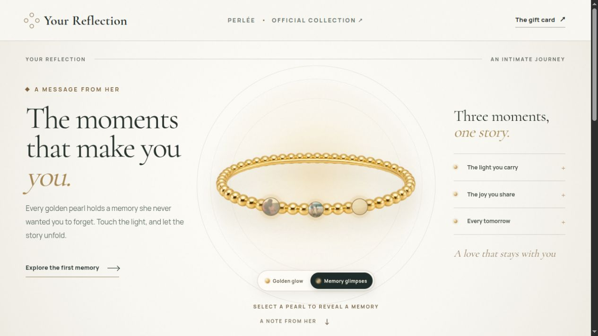

# Your Reflection

**A story in every pearl.** An interactive jewelry gifting concept: a recipient scans the card in a gift box, enters a demo code, and discovers three memories inside a bracelet. Built as an independent presentation demo inspired by the [Van Cleef & Arpels Perlée collection](https://www.vancleefarpels.com/ae/en/collections/jewelry/perlee.html).

> **Independent concept.** This is not an official Van Cleef & Arpels website, product, or integration. The experience links to the official collection.



| Access screen | Revealed memory |
| --- | --- |
|  |  |

[View the video memory](docs/screenshots/04-video.jpg) · [View the printable gift card](docs/screenshots/05-gift-card.jpg)

## What this demo does

1. The gift card shows a QR code and the six-digit demo code **`271846`**.
2. The QR opens the recipient experience on the computer running this project. The recipient enters the code.
3. Three pearls open two sample photos and one sample video. Visitors can switch between **Golden glow** and **Memory glimpses**, use the memory list, and read a note from the giver.
4. The site and gift card link to the official Perlée collection.

The purchase and memory upload flow is conceptual. This repository implements the recipient experience and printable sample card. It uses plain HTML, CSS, JavaScript, a small Python server, and a bundled QR generator; there is no database or external runtime API. Sample media is stored locally so the experience works without downloading assets while presenting.

## Quick start: Docker on the same network

Install and start [Docker with Compose](https://docs.docker.com/compose/install/). Clone or download this repository, connect the host computer and test phone to the **same Wi-Fi or LAN**, then run the launcher for the host operating system from the project directory:

| System | Command |
| --- | --- |
| Linux | `./start-linux.sh` |
| macOS | `./start-macos.sh` |
| Windows | Double-click `start-windows.cmd`, or run `powershell -NoProfile -ExecutionPolicy Bypass -File .\start-windows.ps1` in PowerShell. |

For a fresh clone:

```bash
git clone https://github.com/p-ktz/your-reflection.git
cd your-reflection
./start-linux.sh # or the macOS/Windows launcher above
```

The launcher checks Docker and Compose, detects a LAN IPv4 address, builds and starts the container, waits for the site, then prints the **Site** and **Gift card** URLs. Open the gift card URL, scan its current QR from a phone on the same network, and enter **`271846`**. Keep the host computer and Docker running while people test.

If the wrong network adapter is selected, specify the address yourself:

```bash
./start-linux.sh --ip 192.168.1.23
./start-macos.sh --ip 192.168.1.23
# Windows PowerShell:
powershell -NoProfile -ExecutionPolicy Bypass -File .\start-windows.ps1 -HostIp 192.168.1.23
```

Stop the container from this directory with `docker compose down`. The first build may need internet to fetch the Python base image. The README screenshots contain an **example QR**; a new QR is generated for the host's current LAN address each time you start the normal demo.

### Without Docker

Install Python **3.10+**. No package installation is needed because the QR library is bundled.

```bash
python3 launch_demo.py       # Linux/macOS
py -3 launch_demo.py         # Windows
```

The Python launcher detects the LAN address, updates the QR, prints the URLs, and opens the card. Use `--host YOUR_LAN_IP` if detection chooses the wrong address, or `--no-browser` to skip opening a tab. Press `Ctrl+C` to stop.

### Troubleshooting

| Problem | What to check |
| --- | --- |
| Docker is missing or stopped | Install Docker with Compose, start its engine, then rerun the launcher. The scripts print a specific error for these cases. |
| The phone cannot open the QR | Join the same Wi-Fi or LAN, keep the host awake, allow TCP port `8765` through its firewall, and avoid guest Wi-Fi that isolates devices. |
| The QR points to an old address | Restart the launcher and share the newly generated card. Use `--ip` / `-HostIp` if the wrong adapter was chosen. |
| Port `8765` is busy | Stop the other process or container using the port, then rerun the launcher. |
| Docker reports `PUBLIC_HOST` missing | Use a launcher, or set `PUBLIC_HOST` to the host's LAN IP before running `docker compose up --build`. |

The LAN address is not reachable from another country or network. For a real deployment, use a server with a public domain, HTTPS, and proper access control. A QR code only contains a URL; it does not create network access.

## Develop the front end

Edit `dist/index.html`, `dist/styles.css`, and `dist/app.js`. For automatic browser refresh after saving files in `dist/`, start development mode with the host's LAN address:

```bash
PUBLIC_HOST=192.168.1.23 docker compose -f compose.yaml -f compose.dev.yaml up --build -d
```

In Windows PowerShell, set `$env:PUBLIC_HOST = "192.168.1.23"`, then run `docker compose -f compose.yaml -f compose.dev.yaml up --build -d`. Without Docker, run `python3 launch_demo.py --watch --host YOUR_LAN_IP` (Windows: `py -3 ...`). Stop with `docker compose down` or `Ctrl+C` respectively. Normal Python mode serves saved files immediately but requires a manual browser refresh.

| Customize | File |
| --- | --- |
| Memory titles, copy, photos, video, and order | `memories` in [`dist/app.js`](dist/app.js) |
| Pearl positions, hover size, preview opacity and blur | `MEMORY GLIMPSES CONTROLS` and `.pearl-one` / `.pearl-two` / `.pearl-three` in [`dist/styles.css`](dist/styles.css) |
| Layout, color, typography, motion | [`dist/styles.css`](dist/styles.css) and [`dist/gift-card.css`](dist/gift-card.css) |
| Demo code | `DEMO_CODE` in `dist/app.js`, visible hint in `dist/index.html`, and printed code in `dist/gift-card.html` |

The QR SVG in `dist/assets/` is generated at runtime and ignored by Git. Do not replace it with a fixed QR when distributing the project.

## Project map

```text
.
├── dist/                  Recipient page, gift card, styles, scripts, fonts, sample media
├── docs/screenshots/      Current README screenshots
├── launch_demo.py         LAN HTTP server, QR generation, optional live reload
├── start-linux.sh         One-command Linux Docker launcher
├── start-macos.sh         One-command macOS Docker launcher
├── start-windows.cmd      Windows double-click launcher
├── start-windows.ps1      Windows PowerShell Docker launcher
├── scripts/               Shared Unix launcher logic
├── Dockerfile             Portable container image
├── compose.yaml           Normal LAN demo
├── compose.dev.yaml       Live reload development mode
└── vendor/                Bundled QR library and font license notices
```

## Accessibility and demo limitations

The memory dialog supports keyboard navigation, Escape to close, touch swipes, focus return, visible focus, and reduced-motion preferences. The video has an accessible description and no subtitles. The six-digit code is **a presentation step in client-side JavaScript, not authentication**. Anyone who can reach the LAN server can request the sample media files directly. Do not use this demo to host private memories without adding server-side access control, secure storage, consent handling, and HTTPS.

## Media and licenses

The sample memory media below was downloaded from Wikimedia Commons and edited for this demo. The two photo previews are crops of their respective photos; the video is trimmed, muted, resized, and converted to MP4, with a poster and preview still derived from it. Keep these credits with redistributed copies:

| Asset | Creator and source | License |
| --- | --- | --- |
| `memory-seaside.jpg` and preview | [Shixart1985, *A mother hugs her daughter by the sea*](https://commons.wikimedia.org/wiki/File:A_mother_hugs_her_daughter_by_the_sea._Back_view.jpg) | [CC BY 2.0](https://creativecommons.org/licenses/by/2.0/) |
| `memory-together.jpg` and preview | [Nenad Stojkovic, *Back view of a mother and daughter playing together at the beach*](https://commons.wikimedia.org/wiki/File:Back_view_of_a_mother_and_daughter_playing_together_at_the_beach._(51360385619).jpg) | [CC BY 2.0](https://creativecommons.org/licenses/by/2.0/) |
| `memory-tomorrow.mp4`, poster, and preview | [JaredMcKenzie, *Sunrise Glow Over Surf Beach*](https://commons.wikimedia.org/wiki/File:Sunrise_Glow_Over_Surf_Beach_with_Pink_Horizon_and_Vibrant_Sand_Tones.webm) | [CC0 1.0](https://creativecommons.org/publicdomain/zero/1.0/) |

The bracelet is user-provided concept artwork and is not an official product image. The bundled QR library and fonts retain their notices in [`vendor/`](vendor/). Original project code is licensed under [MIT](LICENSE); third-party media, fonts, and vendor code retain their own terms. Public GitHub visibility does not make the demo code a secure product or imply endorsement by Van Cleef & Arpels.
